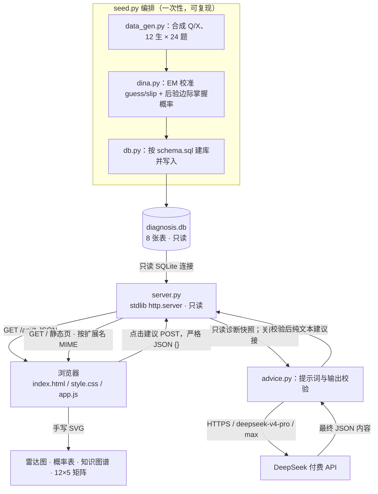

# 架构设计

## 1. 总览

三层、零第三方运行依赖、只读数据库；核心离线，可选建议显式联网：



## 2. 组件

| 组件 | 职责 | 阶段 |
|---|---|---|
| `src/db.py` | 按 `docs/schema.sql` 建库；读写封装；强制数据不变量 | feat |
| `src/data_gen.py` | 合成 12 生 / 24 题（15 单技能 + 9 综合）/ Q 矩阵 / X 矩阵（固定种子） | feat |
| `src/dina.py` | DINA：`fit(Q, X, …)` EM 校准 + 对数后验边际；**不读 profile_id** | feat |
| `src/seed.py` | 编排：建库 → 合成 → 校准 → 落库 | feat |
| `src/server.py` | stdlib HTTP：静态页、核心/状态 GET、建议 POST；只读 DB | 已实现 |
| `src/advice.py` | 当前诊断快照提示词、固定 DeepSeek 请求、传输边界、结构校验 | 已实现 |
| `static/` | 原生 HTML/CSS/JS，雷达图与图谱用手写 SVG | feat |

## 3. 数据流与真值隔离

1. `python3 -m src.seed`（或 `python3 src/seed.py`）→ 建库，写
   `knowledge_point/prerequisite/question/q_matrix/student`，按固定种子生成 `x_matrix`；
   调用 `fit(Q, X, …)` 校准，写 `item_param` 与 `diagnosis`。默认拒绝覆盖已有库，需
   `--force` 显式重建（供测试临时库）。
2. `python3 -m src.server`（或 `python3 src/server.py`）→ 只读库，响应 `/api/*` 与静态资源；
   启动时 DB 不存在则失败（`FileNotFoundError`），绝不隐式建库。
3. 浏览器拉取学生、单生诊断、图谱与全体诊断矩阵，渲染四块视图；学生详情成功后查询免费模型状态。
4. 只有明确点击才 POST 建议；服务校验请求、Host/Origin 和并发门禁，从只读库重读当前合成学生快照，关闭连接后调用 DeepSeek，再校验 JSON 并返回。无自动重试、不重跑 EM、不保存建议、不改变概率。

**真值隔离（关键）**：`fit(Q, X, …)` 只接收 Q 矩阵、X 矩阵与显式数值配置
（先验、guess/slip 区间、迭代上限、容差），**绝不读取 `student.profile_id`**。
`profile_id` 仅用于合成数据生成与 E2E 验证（估计 vs 真值对照），不参与估计、不经 API 暴露。

## 4. 目录结构（已实现）

```
claude-homework-t2WpwB/
├── README.md                     # feat/E2E
├── docs/
│   ├── PRD.md / ARCHITECTURE.md / ER.md / API_CONTRACT.md / schema.sql   # 本轮
│   ├── ALGORITHM.md              # feat（含实测题参与验证）
│   ├── DEVELOPMENT.md            # E2E（1–1.5 页开发过程说明）
│   ├── LLM_SUGGESTIONS.md        # 可选，不阻塞验收
│   ├── PROMPT_LOG.md             # 本轮起，持续记录真实提示词
│   └── superpowers/specs/…design.md  # 本轮设计规格
├── src/  db.py data_gen.py dina.py seed.py server.py advice.py __init__.py
├── static/  index.html style.css app.js
├── tests/  test_schema.py test_seed.py test_dina.py test_api.py test_cli.py test_advice.py test_advice_api.py browser_e2e.cjs advice_e2e.cjs
└── .gitignore
```

## 5. 关键技术选型与理由

| 选型 | 理由 |
|---|---|
| SQLite（`sqlite3` 标准库） | 零依赖、单文件、事务；Q/X 矩阵天然是表 |
| `http.server`（stdlib） | 零依赖，只读 JSON + 静态页足够 |
| 手写 SVG 雷达图/图谱 | 无 CDN、可访问（`role="img"` + `aria-label`）、可控样式 |
| 长表存 Q/X 矩阵 | 关系规范化，逐题/逐生查询友好；Q 缺省 0、禁空知识需求题 |
| 固定随机种子 | 可复现，便于验收与局限对照 |
| EM 数值契约 | 固定均匀先验、对数域 logsumexp、guess/slip 硬区间，见设计规格 §6 |

## 6. 边界与安全

- 服务端**只读**数据库，不写盘、不执行外部命令。
- 无鉴权（本地演示），仅监听 `127.0.0.1`。
- 核心 GET 与状态 GET 无外网；建议 POST 仅访问固定 DeepSeek HTTPS 地址，会产生费用。
- 密钥只由用户主动在服务端环境或隐藏输入提供，不读取 Claude 凭据、旧剪贴板或密钥链；不返回浏览器，不写入日志或仓库。
- 保留默认 TLS 验证、禁止重定向、限制请求/响应体积、并发上限1；socket 空闲超时立即失败，120秒仅为读取块间截止检查。
- GitHub 公开推送属于用户授权的交付操作，由 Codex 编排；应用不执行 Git 或发送邮件。

## 7. 运行与 HTTP 边界

- 服务默认监听 `127.0.0.1`；测试用临时 DB 与 `port=0`（临时端口）；全程零运行依赖。
- `src/seed.py`、`src/server.py` 同时支持 `python3 -m src.seed` / `python3 -m src.server`
  与 README 所述直接脚本启动（`python3 src/seed.py` / `python3 src/server.py`）。
- `Content-Type`：仅 `/api/*` 返回 `application/json; charset=utf-8`；静态资源按扩展名
  各给 MIME（`.html`→`text/html`、`.css`→`text/css`、`.js`→`text/javascript`，均 UTF-8）。
- 核心 GET 路径拒绝非 GET；建议路径只接受 POST，严格 JSON `{}`；其他方法返回405。
- `GET /api/students/{id}`：`id` 须为正整数；非正整数（0、负数、非数字）→ `400 BAD_REQUEST`，
  正整数但不存在 → `404 NOT_FOUND`。
- seed 默认拒绝覆盖已有库（`FileExistsError`）；`--force` 显式重建（供测试临时库）。
- 服务启动时 DB 不存在 → 失败（`FileNotFoundError`），绝不隐式建库。

## 8. 验收状态与分工

完整后端147/147、原前端15/15、建议区模拟E2E6/6通过，见 docs/validation/。真实付费建议成功调用待私下配置运行时密钥。当前文档同步由 Codex 完成，既有源码与测试由 Claude Code 中配置的 DeepSeek 生成。
